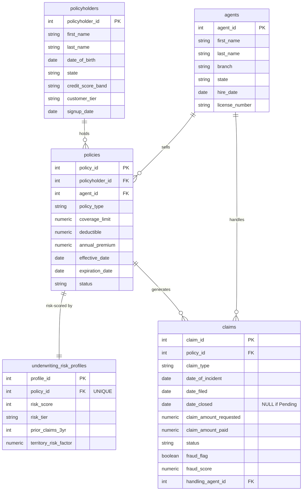

# Apex Mutual Insurance — SQL Portfolio Project

An end-to-end SQL analytics project on a synthetic regional property &
casualty (P&C) insurer. It answers the questions an underwriting,
finance, and claims-operations team actually asks — which lines make
money, who lapses, where fraud hides, and how fast claims settle —
with 10 production-grade PostgreSQL queries over a normalized 3NF
schema and 3,650 claims across 36 months.

> **All data is synthetic**, generated by `generate_data.py`
> (Faker + pandas, seed 42). The findings below describe this dataset,
> not a real company. The methods — CTEs, window functions, cohort
> retention, percentile ranking — transfer directly to real data.

## Business problem

Apex Mutual writes Auto, Home, and Commercial policies across six
Northeast states. Leadership needs to know, before the next rate
filing:

1. **Which lines are profitable?** (loss ratio by line, state, and risk tier)
2. **Who leaves?** (retention and lapse by credit band and age)
3. **Where is the fraud?** (repeat filers and anomalous claim-to-premium ratios)
4. **How fast do claims settle?** (cycle time by handler and severity)
5. **When does the book bleed?** (seasonality and rolling claims volume)

## Company profile — Apex Mutual Insurance

- **Founded:** 1987, Hartford, CT (head office). A mutual insurer —
  owned by its policyholders, not shareholders.
- **Lines of business:** Auto (55% of policies), Home (30%),
  Commercial (15%).
- **Footprint:** CT, MA, NY, RI, NH, VT — six branches (Hartford,
  New Haven, Boston, Providence, Albany, Manchester).
- **Book (this dataset):** 1,250 policyholders, 1,850 policies,
  $6.20M in annual written premium.
- **KPIs leadership watches:** loss ratio, combined ratio, retention
  rate, average settlement cycle time, denial rate, fraud-flag rate.

## Database schema

Five tables, normalized to 3NF. One policyholder can hold several
policies; each policy has exactly one underwriting risk profile and
can have many claims; each claim is handled by one agent.



Full DDL is in [`sql/schema.sql`](sql/schema.sql): primary and
foreign keys, `CHECK` constraints that enforce the business rules
(paid ≤ requested, denied/pending claims pay $0, closed ≥ filed,
monthly premium reconciles to annual premium, 12-month terms), and
15 indexes on the columns the analysis queries actually filter and
join on — including a partial index on `fraud_flag` for the fraud
query.

## Dataset

| Table | Rows | Contents |
| --- | --- | --- |
| `policyholders` | 1,250 | Demographics, state, credit band, tier, signup date |
| `agents` | 24 | Branch, state, hire date, license |
| `policies` | 1,850 | Type, coverage, deductible, premium, term, status |
| `underwriting_risk_profiles` | 1,850 | Risk score/tier, prior claims, territory factor |
| `claims` | 3,650 | Type, incident/filed/closed dates, requested/paid, status, fraud flag |

**Calibrated to be plausible, verified after generation:**

| Measure | This dataset | Target |
| --- | --- | --- |
| Overall loss ratio (paid / premium) | **67.2%** | 60–75% |
| Loss ratio by line | Commercial 70.9%, Auto 68.1%, Home 59.4% | 55–75% each |
| Denial rate | **10.9%** (398 of 3,650) | 10–15% |
| Fraud-flag rate | **2.4%** (88 claims) | ~2–3% |
| Claim window | Jan 2023 – Dec 2025 (36 months) | 24–36 months |
| Seasonal spike | Jan: 352 claims vs Apr: 245 (+44%) | Winter peak |

Two honest caveats, stated here so a hiring manager doesn't have to
find them: claim frequency (~2 claims per policy over 3 years) is
deliberately higher than industry norms so every segment has enough
claims to analyse; and premium does not vary by deductible in the
generator, so Q10 Part B tests frequency and loss ratio by
deductible, not price. Loss ratio, denial, fraud, seasonality, and
cycle-time patterns are the calibrated parts.

## The queries

All 10 are in [`queries/analysis.sql`](queries/analysis.sql), each
self-contained with a business question in its header comment.
Every query uses uppercase keywords, explicit aliases, CTEs instead
of nested subqueries, and `FILTER (WHERE ...)` for conditional
aggregates. All 11 statements (Q10 has two parts) were executed
against the generated data and return results.

| # | Question | Main techniques |
| --- | --- | --- |
| Q1 | Loss ratio by policy type | CTEs, `FILTER`, combined-ratio proxy |
| Q2 | Rolling 90-day claims volume + running cumulative paid, by state | Daily spine (`GENERATE_SERIES`), window frames (`ROWS BETWEEN 89 PRECEDING …`) |
| Q3 | Cohort retention / lapse by age band and credit band | `AGE()`, `CASE` banding, conditional aggregates |
| Q4 | Repeat claimants & anomalous claim-to-premium ratios | `NTILE(10)`, `PERCENT_RANK()`, `LIMIT` triage list |
| Q5 | Settlement cycle time by handling agent & severity | `PERCENTILE_CONT`, median vs mean, % within 14 / after 30 days |
| Q6 | Loss ratio, frequency & severity by state | Separate premium/incurred CTEs (never sum premium across a claims join) |
| Q7 | Monthly seasonality & year-over-year change | `DATE_TRUNC`, `LAG(..., 12)`, rolling 3-month average |
| Q8 | Agent & branch performance: premium, retention, loss ratio | Book vs claims CTEs, `HAVING` minimum book size |
| Q9 | Underwriting: loss ratio by risk tier × credit × prior claims | Multi-way grouping, claim-frequency check on the model |
| Q10 | Severity distribution, large-loss concentration & deductibles | Severity banding, share-of-dollars, deductible trade-off |

## Key insights & strategic recommendations

All numbers below are the actual output of the queries on the
seed-42 dataset (snapshot date 2025-12-31). Total written premium
$6,197,444; total requested $6,290,510; total paid $4,164,688;
average approved payment $1,385.

### 1. The book is profitable — but only just (Q1)

Overall loss ratio **67.2%**. With a 28% expense assumption the
combined-ratio proxy is ~95% — profitable, with thin margin.
Commercial is the worst line at **70.9%** (98.9% combined proxy),
followed by Auto **68.1%** and Home **59.4%**.

**Recommendation:** Commercial needs a rate or underwriting action
first, not Auto — Auto looks worst by claim count (2,226 claims)
but Commercial is worst per premium dollar, with the highest average
severity ($3,598 vs $865 Auto, $1,230 Home).

### 2. The risk model works — an 18-point spread (Q9)

Loss ratio by risk tier: High **76.2%** (2.84 claims per policy),
Medium **66.0%** (2.14), Low **58.1%** (1.72). The score separates
risk; it isn't decoration. The worst durable cell is High-tier
policies with 2+ prior claims (92–93% loss ratio on 56–62 policies).

**Recommendation:** tighten renewal underwriting for High-tier
policies with 2+ prior claims — surcharge, higher deductible, or
non-renewal review — rather than repricing the whole book. (One
cell, Medium/Excellent with 1 prior claim at 150%, rests on only
23 policies: treat as noise, not a pricing signal.)

### 3. Lapse is a credit story, not an age story (Q3)

Retention by credit band: Excellent **76.6%**, Good 73.2%, Fair
60.7%, Poor **56.1%** — and lapse runs the other way, Poor 32.5%
vs Excellent 11.6%. By age, retention barely moves: Under-25
68.9%, 25–39 68.7%, 40–54 71.5%, 55+ 66.6%.

**Recommendation:** spend retention effort (payment plans,
renewal outreach, autopay discounts) on Fair/Poor-credit holders,
where a third of policies lapse. Age-based retention campaigns
would be aiming at the wrong variable.

### 4. Fraud: 88 flags, and the biggest ratio isn't fraud (Q4)

**88 claims (2.4%)** are fraud-flagged; 76 were still approved, 9
denied. The highest claim-to-premium ratio in the book (18.0× —
$10,750 paid on a $597 annual premium, 5 claims on one policy)
carries no fraud flag, while several flagged policies sit lower in
the ranking.

**Recommendation:** route the Q4 triage list (top decile by ratio,
top 5% by percentile, 3+ claims, any fraud flag) to Special
Investigations — but as review, not auto-denial. Ratio alone
catches large legitimate losses too.

### 5. Settlement speed is a severity story (Q5)

Average cycle time: Small claims (<$1k) **11.4 days** (median 11),
Medium ($1k–$5k) **19.6 days** (median 20), Large (>$5k) **34.1
days** (median 33). Overall ~16 days. The slowest handlers on
large claims average ~40 days — but the gap between agents nearly
vanishes once severity is controlled for.

**Recommendation:** set severity-specific service targets (e.g.
14 / 25 / 40 days) instead of one blanket target, and investigate
agents only where they are slow *within* a severity band.

### 6. Winter and late summer are the expensive seasons (Q2, Q7)

January filed **352 claims** vs April's 245 (+44%), and
January–March (985 claims) out-filed April–June (823) by 20%.
August was the most expensive month ($405,476 paid), September
close behind ($393,042).

**Recommendation:** staff claims and pre-position adjusters for
January–March freeze/ice volume and the August–September storm
window; use Q2's rolling 90-day volume by state as the early-warning
series, not raw monthly counts.

### 7. Geography: small books look worst (Q6)

New Hampshire **74.9%** and Vermont 69.6% top the state loss
ratios — but on only 151 and 143 policies. Massachusetts (71.2%,
468 policies) is the large-book concern; Connecticut, the home
state and largest book (539 policies), is 64.4%.

**Recommendation:** don't reprice NH/VT on 150 policies of
evidence; do review MA, where the ratio is high *and* the book is
big enough to believe it.

### 8. A few big claims carry the loss bill (Q10)

Claims over $10k requested are only **2.1% of claims (78)** but
**21.8% of paid dollars**. The $1k–$5k band is the workhorse:
36.9% of claims, 46.1% of paid dollars. On deductibles, there is
no clean pattern in this data (Auto $250: 65.6% loss ratio,
$500: 72.9%, $1,000: 66.0%; frequency flat at ~2.1–2.2) —
consistent with the generator not linking deductible to frequency,
so no deductible recommendation is drawn from it.

### 9. Agent books vary more than branches do (Q8)

Loss ratio by agent (books of 30+ policies) runs from **36.8%**
(Logan Pineda, Hartford) to **97.2%** (Nathan Horton, Hartford).
The top premium writer, Sharon Reed (Albany, $357,728), runs
71.7% — volume and quality are different skills.

**Recommendation:** pair the top-premium / high-loss-ratio agents
with underwriting review on new business; use the low-loss-ratio
agents' books as the model for what "good" looks like.

## Technical skills demonstrated

- **Schema design:** 3NF normalization, PK/FK, `UNIQUE`, `CHECK`
  constraints enforcing business rules, partial indexes
- **Data generation:** Python (`Faker`, `pandas`), seeded and
  reproducible, with a validation block that asserts the loss
  ratio, denial rate, and fraud rate land in their target bands
- **CTEs** to break each question into readable steps
- **Window functions:** `SUM() OVER (ROWS BETWEEN …)`,
  `LAG()`, `NTILE()`, `PERCENT_RANK()`, `PERCENTILE_CONT`
- **Aggregate filters:** `COUNT(*) FILTER (WHERE …)`,
  `SUM(...) FILTER (WHERE …)`
- **Date/time:** `GENERATE_SERIES` daily spine, `DATE_TRUNC`,
  `AGE()`, date arithmetic for cycle time
- **Self-joins / multi-joins** across five tables, including the
  deliberate pattern of summing premium and incurred losses in
  *separate* CTEs so a claims join never inflates premium
- **Cohort analysis** and retention/lapse measurement

## How to reproduce & setup

### Prerequisites

- PostgreSQL 14+ (queries use `GENERATE_SERIES`,
  `PERCENTILE_CONT`, and `FILTER` — all standard in PG 14+)
- Python 3.10+

### 1. Clone the repo

```bash
git clone https://github.com/<your-username>/apex-mutual-insurance-sql.git
cd apex-mutual-insurance-sql
```

### 2. Generate the data (optional — CSVs are already in `data/`)

```bash
python -m venv .venv && source .venv/bin/activate
pip install -r requirements.txt
python generate_data.py            # seed 42, writes data/*.csv
python generate_data.py --seed 7   # a reproducible variant
```

The script prints row counts and a validation block. It asserts
loss ratio 60–75%, denial rate 10–15%, and fraud rate 1.5–4% —
if you change the calibration constants and an assertion fails,
retune `CLAIM_MEDIAN` / `TYPE_SEVERITY` in the script.

### 3. Create the schema and load the data

```bash
createdb apex_mutual
psql -d apex_mutual -f sql/schema.sql
psql -d apex_mutual -c "\copy policyholders FROM 'data/policyholders.csv' WITH (FORMAT csv, HEADER true)"
psql -d apex_mutual -c "\copy agents FROM 'data/agents.csv' WITH (FORMAT csv, HEADER true)"
psql -d apex_mutual -c "\copy policies FROM 'data/policies.csv' WITH (FORMAT csv, HEADER true)"
psql -d apex_mutual -c "\copy underwriting_risk_profiles FROM 'data/underwriting_risk_profiles.csv' WITH (FORMAT csv, HEADER true)"
psql -d apex_mutual -c "\copy claims FROM 'data/claims.csv' WITH (FORMAT csv, HEADER true)"
```

Load in that order — the foreign keys depend on it. The CSVs
already satisfy every `CHECK` constraint (verified: no orphan
rows, no paid > requested, no pending claim with a close date or
payment), so the load should complete with no errors.

Smoke test:

```sql
SELECT COUNT(*) FROM policyholders;  -- 1,250
SELECT COUNT(*) FROM policies;       -- 1,850
SELECT COUNT(*) FROM claims;         -- 3,650
SELECT (SELECT SUM(claim_amount_paid) FROM claims)
     / (SELECT SUM(annual_premium) FROM policies) AS loss_ratio;
                                     -- ~0.67
```

(The last query uses scalar subqueries on purpose — the correct
loss-ratio query is Q1, which sums premium and incurred losses in
separate CTEs. Summing premium across a claims join would count
each policy's premium once per claim.)

### 4. Run the analysis

```bash
psql -d apex_mutual -f queries/analysis.sql
```

Or run one query at a time by copying a Q1–Q10 block into
your SQL client. Snapshot date is 2025-12-31 throughout.

## Project structure

```text
apex-mutual-insurance-sql/
├── README.md
├── requirements.txt
├── .gitignore
├── generate_data.py              # Faker + pandas dataset generator
├── sql/
│   └── schema.sql                # PostgreSQL DDL (3NF, constraints, indexes)
├── queries/
│   └── analysis.sql              # Q1–Q10 analytical queries
└── data/
    ├── policyholders.csv         # 1,250 rows
    ├── agents.csv                # 24 rows
    ├── policies.csv              # 1,850 rows
    ├── underwriting_risk_profiles.csv  # 1,850 rows
    └── claims.csv                # 3,650 rows
```

## Limitations — read before citing

- Synthetic data, seed 42. Frequencies are elevated for analysis;
  do not cite the ~2 claims-per-policy frequency as an industry
  benchmark.
- Premium does not vary by deductible in the generator, so Q10
  Part B cannot support a deductible-pricing recommendation.
- Repeat claimants are capped at 8 claims per policy by design;
  the tail of the claims-per-policy distribution is shaped by
  that cap.
- The 28% expense assumption in Q1's combined-ratio proxy is an
  assumption, not a measured cost.
- Small cells (e.g. a 23-policy slice at 150% loss ratio in Q9)
  are noise until confirmed on more data — the README calls them
  out where they appear.

## Resume bullet

> Built an end-to-end SQL portfolio project on a synthetic P&C
> insurer (Apex Mutual): designed a 3NF PostgreSQL schema with 5
> tables, 1,250 policyholders, 1,850 policies, and 3,650 claims;
> generated the dataset in Python (Faker/pandas) calibrated to a
> 67% loss ratio, 11% denial rate, and 2.4% fraud rate; wrote 10
> analytical queries (CTEs, window functions, cohort retention,
> NTILE/PERCENT_RANK fraud triage) surfacing that lapse is driven
> by credit band (56% retention for Poor vs 77% for Excellent),
> not age, and that High-risk-tier policies run a 76% loss ratio
> vs 58% for Low-risk.
